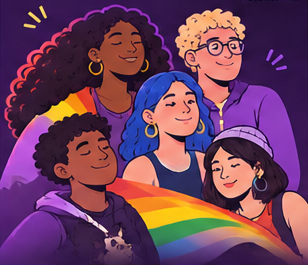

<div align="center">


# Entre Linhas

### Toda escolha abre uma nova perspectiva.

**Um jogo de histórias, escolhas e reflexão sobre as relações que construímos todos os dias.**



<p>
  
  
  
</p>

**Escolhas · Perspectivas · Reflexão**

[Conheça o projeto](#sobre) · [Tecnologias](#tecnologia) · [Execute localmente](#executar) · [Explore a biblioteca](#biblioteca) · [Veja os testes](#testes)

</div>

---

<a id="sobre"></a>
## 🌈 A reflexão começa na escolha

Uma tarefa distribuída por estereótipo. Uma piada que isola alguém. Uma contribuição que passa despercebida. O **Entre Linhas** transforma situações como essas em pequenas jornadas de reflexão sobre gênero, diversidade, empatia e convivência.

O projeto é um protótipo educativo desenvolvido para o contexto do **NUGEDS — Núcleo de Gênero e Diversidade Sexual do IFCE**. Sua proposta é ajudar a perceber o que nem sempre está explícito em uma conversa, em uma regra ou em uma decisão.

Cada história apresenta três caminhos. Depois da escolha, o jogo mostra possíveis efeitos e uma pergunta para aprofundar a reflexão. **Não há pontuação, ranking ou gabarito:** o foco está nas implicações das atitudes e nas diferentes perspectivas envolvidas.

> A reflexão continua fora da tela.

<a id="jornada"></a>
## 🎮 Como funciona a jornada

| Etapa | O que acontece |
| :--- | :--- |
| **1 · Entre** | Acompanhe a abertura animada, conheça a proposta e informe um apelido ou entre como visitante. |
| **2 · Leia** | Receba uma seleção de cinco histórias da biblioteca. |
| **3 · Escolha** | Decida entre três alternativas para a situação apresentada. |
| **4 · Reflita** | Leia o retorno da sua escolha e a pergunta de reflexão. Você pode rever a situação e trocar a resposta. |
| **5 · Continue** | Avance pelas cinco histórias e conclua a jornada. Uma nova rodada sorteia outra seleção. |

O progresso é salvo no navegador. Ao voltar à tela inicial, **Continuar jornada** retoma a etapa em que você parou.

<details>
<summary><strong>Entenda as regras do sorteio e do avanço</strong></summary>

- Cada rodada contém **cinco histórias diferentes**, sorteadas entre as 30 disponíveis.
- O indicador mostra sua posição na rodada, e não o número da história na biblioteca.
- Você precisa escolher uma alternativa para acessar a reflexão e avançar.
- **Rever a situação** permite substituir a resposta atual sem contar a história duas vezes.
- **Jogar novamente** reinicia as respostas e preserva o apelido.
- A nova rodada evita começar pela última história da anterior. Histórias podem reaparecer entre rodadas; não é necessário percorrer toda a biblioteca antes de uma repetição.
- Acesso direto a uma etapa futura e retorno pelo histórico respeitam a fase salva da jornada.

</details>

<a id="executar"></a>
## 🚀 Comece em poucos passos

O jogo usa **HTML, CSS e JavaScript nativo**. Para executá-lo, você precisa de um navegador moderno e de um servidor HTTP local. Não há instalação de pacotes nem etapa de build.

### Opção 1 · Live Server

1. Abra a pasta do projeto no VS Code.
2. Com a extensão Live Server instalada, abra `index.html` usando **Open with Live Server**.
3. Siga a introdução até a tela inicial e clique em **Jogar agora**.

### Opção 2 · Python

Na raiz do projeto, com Python 3 instalado:

```bash
python3 -m http.server 8765
```

Acesse **[http://localhost:8765/](http://localhost:8765/)**.

Para ir direto à tela inicial: **[abrir o jogo](http://localhost:8765/src/pages/inicio.html)**.

> Abra o projeto pelo servidor, não por `file://`: o carregamento das histórias usa `fetch`. Node.js é necessário apenas para os testes, não para jogar.

<a id="recursos"></a>
## ✨ O que já funciona

| Recurso | Implementação atual |
| :--- | :--- |
| Biblioteca | 30 histórias adaptadas, três alternativas por história e 90 consequências específicas. |
| Jornada | Sorteio, escolha, reflexão, revisão da resposta, avanço e conclusão. |
| Retomada | Persistência do apelido, da ordem sorteada, das respostas e da etapa atual. |
| Novas rodadas | Nova seleção de cinco histórias, mantendo o apelido. |
| Recuperação | Avisos para falhas de carregamento, armazenamento bloqueado e progresso incompatível. |
| Revisão editorial | Prévia de histórias e consequências sem alterar a partida. |
| Interface | Estilos compartilhados, foco visível de teclado e ajustes para telas menores. |

<a id="biblioteca"></a>
## 📚 Uma biblioteca para abrir conversas

As histórias abordam temas como divisão de tarefas, reconhecimento profissional, relações de poder, privacidade, expressão de gênero, permanência estudantil e preconceitos que se cruzam.

| Arquivo | Papel no projeto |
| :--- | :--- |
| [historias.json](src/data/historias.json) | Biblioteca carregada pelo jogo: **30 histórias e 90 consequências**. |

Os textos fornecidos com apoio de IA foram adaptados para uma linguagem mais direta e madura, com situações e alternativas resumidas para leitura em celular. Os retornos descrevem possibilidades e custos, sem prometer resultados certos.

O campo `origem` registra a referência editorial local, que não é necessária para executar o jogo. O status **`em_revisao`** registra que adaptação editorial e funcionamento técnico não equivalem a aprovação pedagógica institucional. O status é informativo: as 30 histórias estão disponíveis no protótipo.

<details>
<summary><strong>Como editar ou acrescentar uma história</strong></summary>

Edite [src/data/historias.json](src/data/historias.json), dentro da lista `historias`. Cada registro precisa de:

| Campo | Conteúdo |
| :--- | :--- |
| `id` | Identificador único e estável, como `historia-31`. |
| `titulo` | Título curto da situação. |
| `situacao` | Contexto que será apresentado antes da escolha. |
| `pergunta` | Convite à decisão, como “Como você agiria?”. |
| `opcoes` | Exatamente três alternativas, com IDs distintos, texto e consequência. |
| `reflexao` | Objeto com `titulo`, `texto` geral e `pergunta` de reflexão. |
| `origem` e `status` | Informações editoriais para acompanhar a procedência e a revisão. |

Exemplo de uma alternativa:

```json
{
  "id": "a",
  "texto": "Propor um rodízio de funções.",
  "consequencia": "O rodízio pode ampliar o acesso às tarefas técnicas. A proposta exige negociação e pode encontrar resistência na equipe."
}
```

A consequência escolhida aparece no primeiro cartão da reflexão. Se estiver ausente ou vazia, o jogo utiliza `reflexao.texto`. O título e a pergunta de reflexão são compartilhados pelas três alternativas.

Mantenha a biblioteca com pelo menos cinco histórias válidas. Alterações nos textos ou nas opções tornam rodadas antigas incompatíveis; o jogo permite iniciar outra jornada para não associar respostas antigas ao novo conteúdo.

</details>

<details>
<summary><strong>Como revisar uma história sem jogar uma rodada</strong></summary>

Com o servidor local ativo, use:

```text
src/pages/historia1.html?previa=1&historia=historia-3
src/pages/reflexao1.html?previa=1&historia=historia-3&opcao=a
```

Troque o identificador entre `historia-1` e `historia-30` e a opção entre `a`, `b` e `c`. Sem `opcao`, a prévia da reflexão mostra o texto geral.

As prévias não alteram o progresso e deixam os botões do jogo desativados. Links com apenas `?historia=...` também abrem prévias. Para jogar, comece pela tela inicial.

</details>

<a id="tecnologia"></a>
## 🛠️ Por dentro do projeto

<div align="center">

### As tecnologias por trás de cada escolha

<p>
  
</p>

**HTML5 · CSS3 · JavaScript · Node.js**

<p>
  
  
  
</p>

**Histórias em JSON. Escolhas em JavaScript. Identidade em CSS.**

</div>

| Tecnologia | Uso |
| :--- | :--- |
| **HTML5** | Estrutura das páginas e elementos semânticos. |
| **CSS3** | Identidade visual, componentes e adaptação às telas. |
| **JavaScript · ES Modules** | Navegação, motor da jornada e preenchimento das telas. |
| **JSON** | Separação do conteúdo das histórias e da lógica do jogo. |
| **LocalStorage** | Persistência local do apelido e do progresso. |
| **Node.js e Chrome** | Testes da lógica e do comportamento no navegador. |

<div align="center">

#### 🤖 Apoio ao desenvolvimento


<p>
  
</p>

**Codex** como assistente de IA no desenvolvimento e na documentação do projeto.

</div>

### Organização dos arquivos

```text
entre linhas/
├── index.html                  # Introdução vetorial animada
├── assets/                     # Logo, ilustrações, ícones e áudio
├── src/
│   ├── pages/                  # Telas da experiência
│   ├── css/
│   │   ├── global/             # Cores, base e tipografia
│   │   ├── components/         # Botões, logo, rodapé e avisos
│   │   ├── pages/              # Estilos de cada tela
│   │   └── main.css            # Entrada dos estilos
│   ├── data/
│   │   ├── historias.json      # Biblioteca ativa
│   │   └── storage/            # Persistência do apelido
│   └── js/
│       ├── navigation/         # Rotas e introdução
│       ├── jogo/               # Motor e persistência da rodada
│       ├── historias.js        # Integração entre dados e interface
│       └── main.js             # Entrada compartilhada
└── tests/                      # Testes do motor, fluxo e biblioteca
```

### Animação de entrada

A raiz abre uma composição **SVG animada com JavaScript nativo (Web Animations API)**, reconstruída a partir da introdução original. Sete letras coloridas, o arco e a inscrição formam a marca em aproximadamente cinco segundos; a sequência permanece visível e encerra com fade aos oito segundos, seguindo para as boas-vindas.

- `index.html`: formas vetoriais e link acessível para pular.
- `src/css/pages/entrada.css`: composição responsiva, fundo preto e foco de teclado, sem fontes externas.
- `src/js/navigation/introducao.js`: tempos, trajetórias, áudio opcional e movimento reduzido.
- `src/js/navigation/entrada-seguranca.js`: navegação única e limite independente de 11 segundos para falhas do módulo.
- `assets/audio/introducao.m4a`: áudio original separado, sem transcodificação. Bloqueios de autoplay não interrompem a sequência.

Com movimento reduzido, a marca aparece estática por 1,4 segundo antes do avanço. Sem JavaScript, a marca e o link nativo continuam disponíveis; nesse caso o avanço é manual. A entrada não utiliza player, MP4, canvas ou sequência de imagens. O MP4 original permanece apenas como referência local e é excluído da publicação por `.vercelignore`.

Para validar a introdução, com o servidor e Chrome de testes descritos abaixo ativos:

```bash
node tests/introducao-navegador.mjs
```

As capturas e o relatório desse teste ficam em `docs/evidencias-introducao/`. A vetorização conserva a composição da referência; interpolação, rasterização e rastros são aproximações, não uma reprodução pixel a pixel. A escala em desktop se adapta à viewport, sem simular uma tela de vídeo vertical.

`historia1.html` e `reflexao1.html` são **telas reutilizáveis**: os nomes dos arquivos foram mantidos, mas elas exibem qualquer história da biblioteca. Não existe uma cópia de HTML para cada situação.

<details>
<summary><strong>Onde o progresso fica salvo?</strong></summary>

| Chave | Dados |
| :--- | :--- |
| `entreLinhas.apelido` | Apelido usado na saudação da tela inicial. |
| `entreLinhas.jornada.v1` | Ordem sorteada, posição, fase, respostas e informações de compatibilidade da rodada. |

A aplicação não envia essas escolhas a um backend. O progresso pertence ao navegador e à origem usados para abrir o jogo; não há conta, autenticação ou sincronização entre dispositivos.

Limpar os dados do site remove o progresso. Alterar host ou porta também muda a origem de armazenamento. Se o navegador bloquear a persistência, o jogo informa o problema antes de avançar.

As fontes são carregadas do Google Fonts, com alternativa local `sans-serif` quando indisponíveis. A tela inicial contém informações de privacidade e uma ação para apagar somente o apelido e a jornada, mediante confirmação.

</details>

<a id="identidade"></a>
## 🎨 Uma identidade compartilhada

A interface combina fundo roxo escuro, cartões em tons de violeta, texto claro e ondas com as cores do arco-íris. Os elementos visuais vêm dos próprios arquivos do projeto.

| Elemento | Definição |
| :--- | :--- |
| Fundo principal | `#1C0B2D` |
| Superfície dos cartões | `#341748` |
| Ação principal | `#8D2FD0` |
| Destaques | `#DFABFF` |
| Títulos | **Poppins · 700** |
| Textos | **Inter · 400** |

As cores estão em [thames.css](src/css/global/thames.css), a tipografia em [typography.css](src/css/global/typography.css) e os ícones em [assets/icons](assets/icons). Os estilos são integrados por [main.css](src/css/main.css).

<a id="testes"></a>
## 🧪 Testes e validação

| Camada | Cobertura |
| :--- | :--- |
| **13 testes do motor** | Biblioteca, sorteio, escolhas, revisão, conclusão, consequências e persistência. |
| **15 cenários no Chrome por viewport** | Jornada completa, retomada, novas rodadas, histórico, prévias e falhas em 390 × 844 e 1366 × 768. |
| **360 verificações da biblioteca** | 30 situações e 90 consequências em **320 × 568**, **390 × 844** e **1366 × 768**. |
| **105 verificações de interface** | Seis resoluções, texto a 200%, teclado, contraste, movimento reduzido e privacidade. |
| **8 cenários adicionais de falha e navegação** | HTTP, JSON, timeout, quota, recuperação, ajuda, créditos e fontes indisponíveis. |

Essas verificações passaram na revisão de QA de 20/11/2026. Os resultados descrevem testes locais; não representam uma certificação de acessibilidade ou testes em todos os aparelhos.

### Testar a lógica

Com **Node.js 24 ou superior**, execute na raiz:

```bash
node tests/motor.test.mjs
```

Não é necessário instalar dependências.

<details>
<summary><strong>Executar os testes reais de navegador</strong></summary>

Mantenha o servidor local ativo na porta **8765**. Em outro terminal, inicie um Chrome com perfil separado e depuração na porta **9222**. Exemplo para Linux:

```bash
google-chrome --headless --disable-dev-shm-usage \
  --remote-debugging-port=9222 \
  --user-data-dir=/tmp/entre-linhas-testes \
  about:blank
```

Com os dois processos ativos, execute os testes, um de cada vez:

```bash
node tests/navegador.mjs
```

```bash
node tests/biblioteca-navegador.mjs
```

Os testes alteram apelido e progresso no perfil utilizado. Use um perfil exclusivo de teste. Em outros sistemas, ajuste o caminho do executável do Chrome.

A validação da biblioteca verifica textos, alternativas, consequências, fontes, imagens, marcadores e transbordamento. Zoom, textos futuros mais longos ou telas menores podem exigir rolagem; o conteúdo permanece acessível.

</details>

<a id="contribuir"></a>
## 🤝 Como contribuir

Contribuições podem melhorar a escrita das histórias, a acessibilidade, o código ou a experiência de uso.

1. Descreva o problema ou a proposta com um exemplo concreto.
2. Preserve as cores, fontes e componentes compartilhados.
3. Ao editar histórias, mantenha a origem dos textos e descreva consequências sem transformar o jogo em um teste de certo e errado.
4. Execute os testes correspondentes à alteração.
5. Diferencie uma sugestão editorial de conteúdo já validado pedagogicamente.

O protótipo está funcional. A revisão pedagógica dos textos e a avaliação com pessoas usuárias seguem como próximos passos.

---

<div align="center">

**Entre Linhas**

Escolhas que convidam à escuta. Reflexões que acompanham a convivência.

[Voltar ao início](#entre-linhas)


</div>

## Segurança e arquivos locais

O repositório contém a aplicação, os testes e a configuração da hospedagem.
Rascunhos, relatórios e evidências geradas ficam em `docs/`, ignorado pelo Git.
Os testes que geram resultados criam essa pasta automaticamente.
Nunca inclua credenciais no código do cliente: os arquivos usados pelo navegador são públicos.

`vercel.json` configura CSP e cabeçalhos de segurança; `.vercelignore` limita os arquivos enviados para hospedagem.
Após publicar, confirme os cabeçalhos no domínio real e revise 2FA e proteção dos previews no painel da Vercel.
